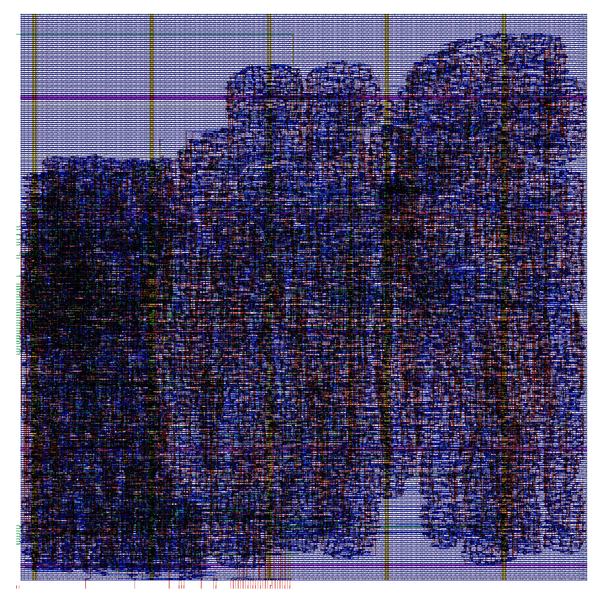

# Systolic Accelerator


An int8 **matrix-multiply accelerator for neural networks**, built around a 4×4 **systolic array** (the same architecture as Google's TPU), written in Verilog. It's connected to the RISC-V CPU from [elvisamaya/processor](https://github.com/elvisamaya/processor) as a memory-mapped device, runs a quantized neural network bit-exactly, and is taken through synthesis and place-and-route on **SkyWater 130nm** to a DRC- and LVS-clean layout.

## Results

**88× faster than the CPU alone.** C = A·B with A 4×K and B K×4, run on the Verilog SoC:

| K | RISC-V only (cycles) | RISC-V + accelerator (cycles) | array busy | speedup |
|---:|---:|---:|---:|---:|
| 8  |  9,957 | 250 | 16 (6%) | 39.8× |
| 16 | 19,113 | 336 | 24 (7%) | 56.9× |
| 32 | 38,981 | 514 | 40 (8%) | 75.8× |
| 64 | 75,661 | 864 | 72 (8%) | 87.6× |

The array itself is busy for only 8% of the accelerated run. The rest is the CPU copying operands in and results out. **Data movement, not arithmetic, is the bottleneck**, which is why real accelerators use DMA engines and large on-chip SRAMs. (The software baseline is RV32I, which has no multiply instruction; a CPU with a hardware multiplier would narrow the gap.)

**A real neural network, bit-exact in hardware.** A 64→32→10 MLP trained on 8×8 handwritten digits, quantized to int8, with every matrix multiply executed on the simulated accelerator:

| | accuracy (360 test images) |
|---|---:|
| float32, NumPy | 96.4% |
| int8, NumPy | 95.8% |
| **int8, on the accelerator** | **95.8%**, every layer output identical to NumPy |

That's 875,520 multiply-accumulates in 62,640 array cycles: **14.0 MACs/cycle** of a 16 peak.

**Synthesized to SkyWater 130nm** (`sky130_fd_sc_hd`, typical corner, Yosys + ABC; pre-layout):

| design | cells | flip-flops | area (µm²) | critical path (ns) | est. Fmax (MHz) |
|---|---:|---:|---:|---:|---:|
| PE (int8 MAC) | 1,754 | 49 | 9,160 | 2.62 | 325 |
| 2×2 array | 6,932 | 178 | 35,495 | 2.71 | 316 |
| 4×4 array | 25,974 | 806 | 134,944 | 2.76 | 312 |
| 8×8 array | 104,139 | 3,409 | 539,012 | 2.87 | 302 |
| accelerator, N=4, KMAX=16 | 29,801 | 1,879 | 178,197 | 3.35 | 263 |
| accelerator, N=4, KMAX=64 | 51,134 | 4,955 | 321,211 | 3.68 | 242 |

- **Area grows with N², but the clock stays flat.** Every wire in a systolic array connects neighbors only, so a 16× larger array is just 7% slower. That's why the architecture scales to TPU sizes.
- **Memory dominates.** At KMAX=64 the operand buffers (4,096 flip-flops) take about 58% of the area. Real chips use SRAM macros instead of flip-flops.
- **The buffer read mux costs about 0.9 ns** in front of the array; a pipeline register there is the obvious next optimization.

At ~250 MHz the 4×4 array peaks at 16 MACs/cycle ≈ **4 GMAC/s**.

## Physical design (OpenLane 2, SkyWater 130nm)

The accelerator (N=4, KMAX=16) taken all the way from RTL to a **GDSII layout**: floorplan, placement, clock-tree synthesis, routing, then signoff (design-rule check, layout-vs-schematic, static timing across 9 process/voltage/temperature corners). Run by `.github/workflows/openlane.yml` on GitHub's machines.



| metric | result |
|---|---:|
| die area | 573,361 µm² (≈ 0.76 × 0.76 mm) |
| standard cells | 32,129 (1,879 flip-flops, 395 clock buffers) |
| core utilization | 42% |
| routed wire length | 0.77 m |
| power (typical) | 20 mW |
| DRC errors (Magic / KLayout / router) | **0 / 0 / 0** |
| LVS errors | **0** |
| setup slack @ 100 MHz, typical corner (25 °C, 1.8 V) | **+1.13 ns** ✅ |
| setup slack @ 100 MHz, fast corner (−40 °C, 1.95 V) | +3.03 ns ✅ |
| setup slack @ 100 MHz, slow corner (100 °C, 1.6 V) | −6.72 ns ❌ |
| hold violations, typical and fast corners | 0 ✅ |
| hold violations, slow corner | 15 ❌ |
| remaining antenna violations | 32 |

**What this says:**
- The layout is **manufacturable as drawn**: no DRC errors, and LVS confirms it matches the netlist.
- It **meets 100 MHz at the typical corner**, but not at the slow corner (hot, low voltage), where it would need roughly a 17 ns clock (~60 MHz).
- Post-layout timing is far worse than the 3.35 ns pre-layout estimate above. Wires, clock skew (up to 0.68 ns) and I/O timing constraints all add delay. **Pre-layout numbers are optimistic**, which is exactly why physical design matters.
- To make it production-ready: register the buffer outputs (the known critical path), constrain I/O timing for the real system, and add margin for hold fixing at the slow corner.


## How it works

### The systolic array

```
               B[k][0]   B[k][1]   B[k][2]   B[k][3]      (column j delayed j cycles)
                  |         |         |         |
  A[0][k]  ---> [PE] ----> [PE] ----> [PE] ----> [PE]
                  |         |         |         |
  A[1][k] -D--> [PE] ----> [PE] ----> [PE] ----> [PE]      each PE:  acc += a * b
                  |         |         |         |                    pass a right, b down
  A[2][k] -DD-> [PE] ----> [PE] ----> [PE] ----> [PE]
                  |         |         |         |
  A[3][k] DDD-> [PE] ----> [PE] ----> [PE] ----> [PE]      PE(i,j) ends up holding C[i][j]
```

- **Output-stationary:** each PE keeps its own 32-bit result while the operands flow past.
- **Skewing:** row *i* enters *i* cycles late and column *j* enters *j* cycles late, so `A[i][k]` and `B[k][j]` meet in PE(*i*,*j*) on the same cycle.
- **Timing:** one column of A and one row of B go in per cycle. The last result is ready 2N−2 cycles after the last input, so a job takes **K + 2N cycles**.

### The accelerator (`rtl/accel.v`)

| offset | register | |
|---|---|---|
| `0x000` | CTRL | write 1 to start |
| `0x004` | STATUS | bit 0 busy, bit 1 done |
| `0x008` | K | inner dimension, clamped to 1..KMAX |
| `0x00C` | CYCLES | performance counter for the last job |
| `0x010` | INFO | `{KMAX, N}` |
| `0x400` | A buffer | column *k* of A packed into one word (4 × int8) |
| `0x800` | B buffer | row *k* of B packed into one word |
| `0xC00` | C | N×N int32 results |

A is stored **column by column** so that one 32-bit word is exactly one column, which is what the array consumes each cycle.

### The SoC (`rtl/soc/`)

The 5-stage pipelined RISC-V core from [processor](https://github.com/elvisamaya/processor), with its data memory moved behind a bus. RAM sits at `0x0000_0000` and the accelerator at `0x4000_0000`. The CPU drives the accelerator with ordinary `lw`/`sw` instructions (`programs/matmul_accel.s`).

## Verification

```
NumPy golden model:  C = A.astype(int32) @ B.astype(int32)
        │
regress.py / nn_demo.py ──► job file ──► Verilog testbench ──► accelerator ──► results ──► compare bit-for-bit
```

- **Unit tests:** PE (20,000 random MAC steps plus extremes), array at N = 2, 4, 8 (200 random jobs each), accelerator at N = 4, 8 through its bus (identity, all −128 at K=KMAX, busy-write protection, K clamping, exact cycle count).
- **Golden-model regression:** 2,400 jobs, about **3.1 million multiply-accumulates**, mixing uniform random matrices with targeted cases (all ±extremes, K=1, K=KMAX, single nonzero entries, sparse values).
- **System tests:** the RISC-V SoC runs both programs at four sizes and must match NumPy. The neural network's every layer output must match NumPy exactly.
- **Planted bugs:** each one, introduced alone, must make the regression fail. **8 out of 8 caught.**

  | planted bug | caught by |
  |---|---|
  | multiply treats int8 as unsigned | `tb_pe` |
  | product not sign-extended to 32 bits | `tb_pe` |
  | accumulator never cleared between jobs | `tb_pe` |
  | B skew off (every column delayed by 1) | `tb_array` |
  | valid not propagated with the data | `tb_array` |
  | drain one cycle too short | `tb_accel` |
  | buffers writable while busy | `tb_accel` |
  | K not clamped to KMAX | `tb_accel` |

- **Lint:** Verilator `-Wall` clean at N=4, N=8 and for the whole SoC. CI runs lint, every test and synthesis on each push.

## Running it

Requires Icarus Verilog, Python 3 with NumPy and scikit-learn; Verilator and Yosys are optional.

```bash
make            # unit tests, golden-model regression, SoC benchmark, neural network
make soc        # just the speedup table
make nn         # just the neural network
make synth      # SkyWater 130nm synthesis table (downloads the cell library)
make lint
```

Full place-and-route: **Actions → openlane → Run workflow** runs OpenLane 2 (floorplan, placement, clock tree, routing, DRC/LVS signoff) on GitHub's machines (about 30 minutes). It uploads the GDSII layout and a rendered picture, and puts the signoff metrics in the run summary.

## Layout

```
rtl/            pe.v, systolic_array.v, accel.v
rtl/soc/        cpu_pipe.v (RISC-V core from elvisamaya/processor), soc.v, memories
tb/             unit testbenches, tb_accel_jobs.v (runs Python job files), tb_soc.v
programs/       matmul_accel.s, matmul_sw.s
scripts/        accel_model.py (golden model), regress.py, nn_demo.py, soc_bench.py,
                synth_report.py, rvasm.py
openlane/       place-and-route configuration
docs/           layout picture
```

## Next steps

- [ ] Register the buffer outputs (one pipeline stage) to remove the buffer-mux penalty, then close timing at the slow corner
- [ ] Replace flip-flop buffers with SRAM macros (OpenRAM) and add a DMA engine so the CPU doesn't copy data
- [ ] Weight-stationary dataflow, and an 8×8 or 16×16 array
- [ ] Run on an FPGA alongside the RISC-V core
